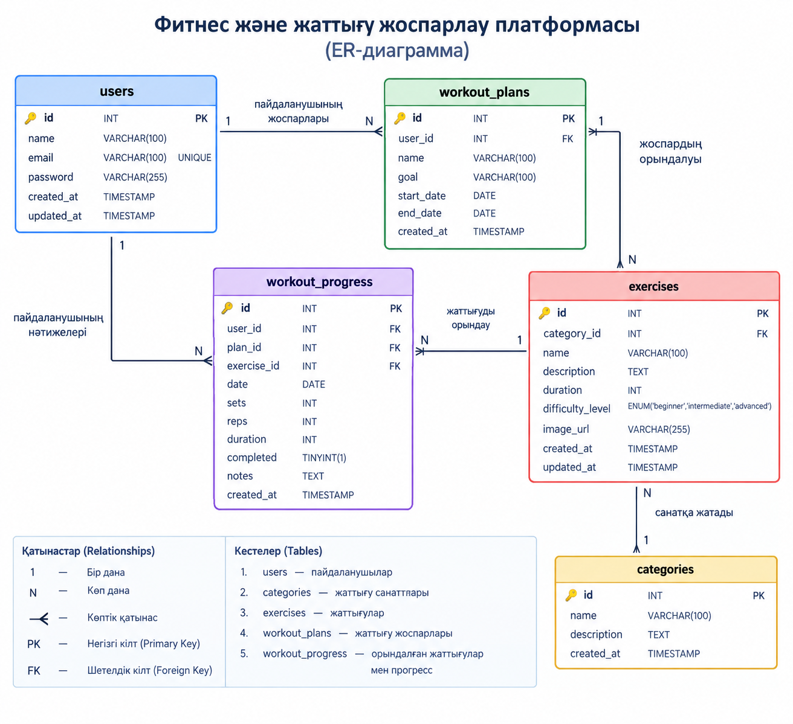

# Фитнес және жаттығу жоспарлау платформасы 

## Жоба туралы

Бұл веб-қосымша пайдаланушыларға жеке фитнес бағдарламаларын құруға, жаттығуларды жоспарлауға және өздерінің физикалық белсенділігін бақылауға мүмкіндік береді. Пайдаланушылар жаттығуларды түрлері бойынша іздеп, санаттарға бөліп, жеке жаттығу жоспарларын құрып, нәтижелерін бақылай алады. Жоба PHP және MySQL технологияларының көмегімен әзірленеді.

## Негізгі мүмкіндіктер

- **Пайдаланушыларды тіркеу және жүйеге кіру (Authentication)** — жеке аккаунт құру және авторизациядан өту.
- **Жаттығуларды басқару (CRUD)** — жаттығуларды қосу, қарау, өңдеу және жою.
- **Жаттығу жоспарларын құру** — жеке мақсаттарға сәйкес күнделікті және апталық жаттығу кестесін жасау.
- **Жаттығуларды іздеу** — жаттығу атауы, түрі және бұлшықет тобы бойынша іздеу.
- **Санаттар бойынша сүзу** — кардио, күш жаттығулары, созылу және басқа санаттарды таңдау.
- **Жаттығу нәтижелерін бақылау** — орындалған жаттығуларды белгілеу және прогресті бақылау.
- **Қауіпсіздік және деректерді валидациялау** — пайдаланушы енгізген мәліметтерді тексеру және деректерді қауіпсіз сақтау.

## Дерекқор құрылымы 

- **users** — пайдаланушылардың жеке аккаунттары, электрондық пошта мекенжайлары және құпиясөздерінің хэштелген нұсқалары.
- **categories** — жаттығулардың санаттары (кардио, күш жаттығулары, созылу және т.б.).
- **exercises** — жаттығулар туралы ақпарат: атауы, сипаттамасы, ұзақтығы, күрделілік деңгейі және санаты.
- **workout_plans** — пайдаланушылардың жеке жаттығу жоспарлары, жоспар атауы және жоспарланған күндер.
- **workout_progress** — орындалған жаттығулар, қайталану саны, ұзақтығы және пайдаланушының прогресі.

## Технологиялар

- **Frontend:** HTML5, CSS3, JavaScript
- **Backend:** PHP
- **Database:** MySQL (PDO арқылы дерекқорға қосылу)
- **Version Control:** Git және GitHub

## Жобаны іске қосу

1. Репозиторийді компьютерге көшіріңіз:

   ```bash
   git clone <repository-url>
   ```

2. Жоба бумасына өтіңіз:

   ```bash
   cd fitness-workout-platform
   ```

3. XAMPP немесе басқа PHP және MySQL ортасын іске қосыңыз.

4. MySQL дерекқорын құрып, жобаға қажетті кестелерді жасаңыз.

5. Дерекқорға қосылу параметрлерін конфигурация файлына енгізіңіз.

6. Жобаны жергілікті сервер арқылы ашыңыз.

## Қауіпсіздік

- Құпиясөздерді қауіпсіз хэштеу.
- SQL Injection шабуылдарының алдын алу үшін PDO және Prepared Statements қолдану.
- Пайдаланушы енгізген деректерді тексеру және сүзгілеу.
- Сессиялар арқылы авторизацияны басқару.
- Жеке пайдаланушының деректеріне рұқсатсыз қол жеткізуді шектеу.

## Жобаның мақсаты

Фитнес және жаттығу жоспарлау платформасының мақсаты — пайдаланушыларға жаттығуларын тиімді ұйымдастыруға, жеке мақсаттарын белгілеуге және физикалық белсенділігінің нәтижелерін бақылауға көмектесетін ыңғайлы әрі қауіпсіз веб-қосымша әзірлеу.


## ER-диаграмма

Фитнес және жаттығу жоспарлау платформасының
дерекқор құрылымы мен кестелер арасындағы байланыстар:


